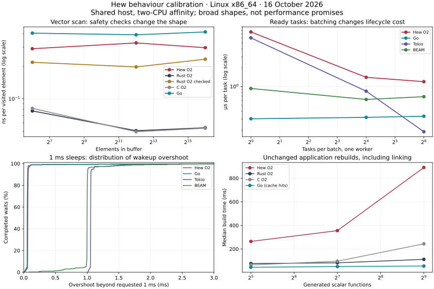

# Behaviour calibration: 16 October 2026

Hew's scalar arithmetic and shared-byte operations are broadly in the native
baseline range in these workloads. Checked vector loops, collection growth,
task lifetimes and actor calls introduce different, measurable costs. These
results identify where safety semantics explain part of the cost and where
further implementation profiling would be useful.

## Scope and evidence

The compiler is `hew 0.6.1-dev.336+67622eaa57`, with its matching native library.
Comparators are Rust 1.96.0, Clang 21.1.8, Go 1.26.0, Tokio 1.53.1 and Erlang/OTP 27. The host is Linux x86_64 on a Ryzen 9 7950X. Measurements inherited a
two-CPU affinity and concurrency used one or two workers.

This was a busy shared host: load averages during the two complete runtime
passes ranged roughly from 25 to 41. Filesystem contention also stalled an
independent repository lint attempt. Broad relationships repeated across the
passes; close timings and individual latency tails should not be generalized.
Only Linux execution was tested.

Each case has one discarded warmup process and five measured processes. Results
were checked before accepting timings. Build measurements use three invocations,
separating the first in a fresh output directory from two unchanged rebuilds.
Existing machine/toolchain caches remain in use. The checked-Rust control was
measured separately after the full matrix.

The retained data includes [full tables](2026-10-16-full-tables.md),
[runtime/build/allocation samples](2026-10-16-linux-x86_64.json) and the
[checked-Rust control](2026-10-16-rust-checked.json). Fixture digests, compiler
version/hash, platform and load information accompany the samples. See the
[suite methodology](../README.md) for timing boundaries and semantic differences.

## Primitive costs

Representative medians, rounded to show the scale. Times cover the whole batch.
The byte-copy batches are particularly short; their small differences are not
actionable conclusions.

| Batch                                               |   Hew O2 |  Rust O2 | Rust O2 checked |     C O2 |      Go |
| --------------------------------------------------- | -------: | -------: | --------------: | -------: | ------: |
| 1 million scalar recurrence steps                   |   2.3 ms |   2.4 ms |          2.3 ms |   2.3 ms |  2.7 ms |
| About 1 million vector reads, 4,096-element buffer  |  0.33 ms | 0.051 ms |         0.20 ms | 0.050 ms | 0.39 ms |
| Grow, read and release 64 vectors of 4,096 elements |   1.4 ms |  0.21 ms |         0.31 ms |  0.25 ms |  2.4 ms |
| 100,000 shared-byte snapshots and reads             |  0.30 ms |  0.26 ms |         0.27 ms |  0.29 ms | 0.13 ms |
| 256 preserved-copy mutations of 4,096 bytes         | 0.013 ms | 0.014 ms |        0.013 ms | 0.011 ms | 0.41 ms |

The scalar result does not suggest a general arithmetic code-generation penalty.
The vector scan gap changes substantially when Rust's overflow checks are
enabled: roughly sixfold against ordinary Rust O2 becomes under twofold against
checked Rust. Inspection of Hew's generated LLVM shows scalar checked additions
and a bounds-failure edge in the inner loop. This supports arithmetic safety and
loop optimization as contributors; the experiment does not isolate the cost of
each check or prove that every remaining check is necessary.

Vector growth remains several times more expensive than checked Rust. Native
allocator growth is similar: about 12 allocation events and 66 KB requested per
4,096-element Hew vector, versus 11 events and 66 KB for Rust/C. The larger time
gap therefore warrants looking at the generated push, traversal and cleanup
paths in addition to allocator policy. Requested bytes count all growth events,
rather than peak live storage.

Shared snapshots have approximately zero incremental allocations in all native
allocator probes. Copy-on-write mutation requests one new allocation of about
4 KB in Hew, Rust and C. Go's shared slice has different guarantees: mutation
can affect aliases unless the programmer explicitly copies. Its copying result
also includes its ordinary allocation and garbage-collection policy.

## Task and actor behaviour

These are analogous operations with different runtime contracts. BEAM creates
monitored processes with isolated heaps. Tokio request/reply uses a fresh
oneshot channel, Go reuses each client's reply channel, and Hew completion is
intrinsic to the actor call.

| One-worker workload                         |       Hew O2 |       Tokio |           Go |         BEAM |
| ------------------------------------------- | -----------: | ----------: | -----------: | -----------: |
| 4,096 ready tasks, batch size 1             |  about 28 ms | about 25 ms | about 1.2 ms |   about 4 ms |
| 4,096 ready tasks, batch size 64            |       4.9 ms |     0.77 ms |       1.4 ms |       2.8 ms |
| 64 worker clients, 256 completed calls each |        32 ms |      2.0 ms |       2.9 ms |       5.3 ms |
| Root-to-actor round trip, median operation  | about 5–7 µs |  about 6 µs | about 0.2 µs | about 0.3 µs |

Batching substantially reduces Hew and Tokio ready-task costs. Two workers do
not consistently improve the smallest operations; handoff, synchronization
and host contention can outweigh additional concurrency. Actor fanout improves
with two workers in the measured Hew batches, but retains a substantial gap
against the comparison runtimes. O0/O2 often changes less here than in vector
loops, pointing toward runtime/lifecycle work as a useful investigation area.

The native allocator probe reports roughly 14 allocation events and 1 KB per
ready-task lifecycle for Hew, versus roughly one event and 140 bytes for Tokio.
Root-to-actor requests report roughly 17 events and 1.3 KB for Hew, versus one
event and 72 bytes for Tokio. These include the corresponding task/collection
or completion machinery. They do not say which events implement essential
guarantees and which are avoidable bookkeeping.

The actor allocation probe omits per-operation timing and latency formatting.
An initial probe included that reporting work and overstated the actor cost;
the retained allocation data uses the corrected path. Timed latency runs still
collect samples, with JSON formatting after their timed interval.

## Timers and footprint

For sequential 1 ms sleeps, Hew and Go typically completed a wait in roughly
1.06 ms. Tokio and BEAM were nearer 2 ms. The empirical distribution shows that
resolution difference more clearly than a single average. It is a property of
these timer paths and settings; the run does not establish busy-worker wakeup
tails, fairness or deadline reliability under overload.

Typical peak process RSS was roughly 1–6 MiB for these Hew/Go/Tokio workloads
and 57–59 MiB for BEAM. RSS includes process/runtime setup and reporting, and
is distinct from useful payload memory or per-operation allocation. It is
useful ecosystem footprint information, not a measure of equivalent guarantees.

## Application compilation

Hew O2 took about 0.54 seconds for the primitive program and 0.97 seconds for
the concurrency program in the retained full run. Unchanged rebuilds had
similar costs because Hew compiles again. Go rebuilds were about 0.05 seconds;
Cargo/Tokio's unchanged build was about 0.04 seconds after a first artifact build
of about 3.5 seconds. These cache behaviours are deliberately reported separately.

For generated scalar-function programs, Hew O2 unchanged-build medians increased
from roughly 0.26 seconds at 32 functions to 0.89 seconds at 512. Rust rose from
roughly 0.08 to 0.11 seconds, C from 0.06 to 0.24 seconds, while Go cache-hit
rebuilds stayed around 0.05 seconds. The simple workload shows a visible Hew
compile/optimization cost; it cannot characterize generic expansion, large
dependency graphs or actor-heavy compilation.

## Useful next investigations

1. Examine vector-loop bounds and overflow reasoning, retaining Hew's failure
   semantics while identifying checks the compiler can prove redundant.
2. Profile collection growth and release to explain the time gap that remains
   despite similar allocation volume.
3. Attribute task/actor allocation and handoff work to the guarantees it serves,
   then investigate repeated or avoidable completion/cleanup bookkeeping.
4. Add representative busy-worker, overloaded-mailbox and cancellation workloads
   before drawing service-level conclusions from the idle latency samples.

The suite and its checks execute successfully. Repository-wide `make lint` was
attempted but interrupted while Rust formatting remained blocked on filesystem
I/O; it produced no full lint verdict. Focused runner failure controls and
fixture execution/format checks passed. No compiler or runtime implementation
was changed by this calibration work.
